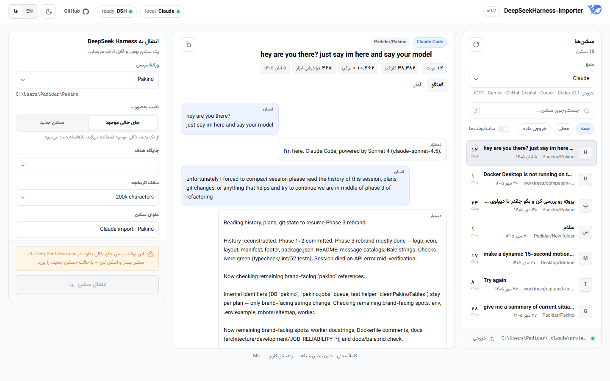
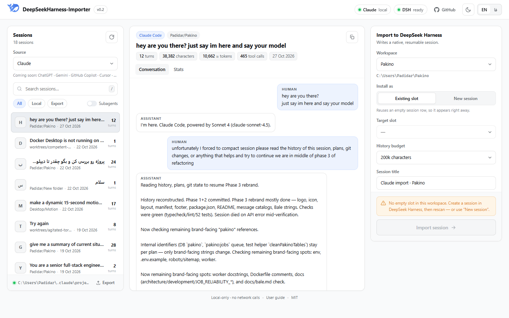
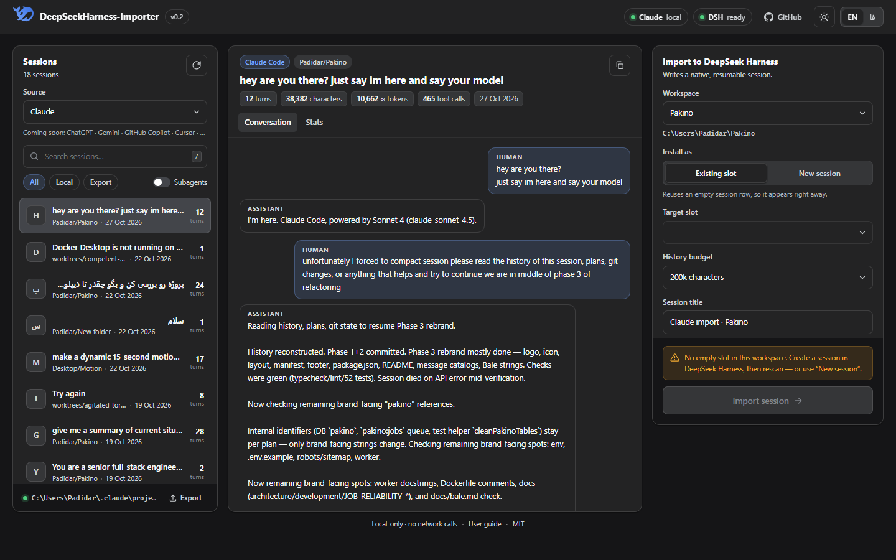
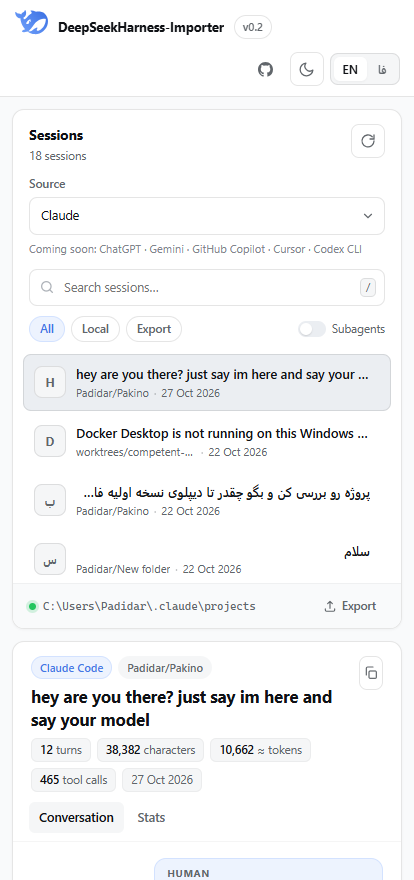

<div dir="rtl">

# DeepSeekHarness-Importer

**گفتگوهای ابزارهای دیگر هوش مصنوعی را به [DeepSeek Harness](https://github.com/deepseek-ai) بیاور: به‌شکل سشن‌های بومی و قابل‌ادامه — از یک داشبورد محلی و بدون ارسال هیچ داده‌ای به بیرون.**

در این نسخه **کلاد** پشتیبانی می‌شود. انتخاب‌گر منبع و خط لوله‌ی تبدیل برای بقیه آماده است: ChatGPT، Gemini، Copilot، Cursor و Codex همین حالا در رابط به‌عنوان «به‌زودی» دیده می‌شوند.



[English](README.md) · [راهنمای کاربر](docs/USER-GUIDE.fa.md) · [User guide](docs/USER-GUIDE.md) · [معماری](docs/ARCHITECTURE.md)

---

DeepSeek Harness (به‌اختصار DSH) سشن‌ها را در یک لاگ JSONL فقط‌افزودنی و فشرده‌شده با Zstandard نگه می‌دارد و هر سشن فقط وقتی در سایدبار می‌آید که شناسه‌اش در رجیستری ورک‌اسپیس ثبت شده باشد. هیچ دکمه‌ی «ایمپورت» وجود ندارد. این ابزار همان شکاف را پر می‌کند: تاریخچه را می‌خواند، به **فرمت نسخه ۴** سشن DSH تبدیل می‌کند و در ورک‌اسپیس انتخابی نصب می‌کند تا سشن با همان تاریخچه باز شود و از همان‌جا ادامه بدهی.

## منابع

| منبع | وضعیت | روش خواندن |
|---|---|---|
| **Claude** | ✅ فعال | سشن‌های محلی Claude Code / Claude Desktop در `~/.claude/projects` و فایل خروجی حساب (`conversations.json`) |
| ChatGPT | 🕓 برنامه‌ریزی‌شده | فایل خروجی داده |
| Gemini | 🕓 برنامه‌ریزی‌شده | خروجی Takeout / Activity |
| GitHub Copilot | 🕓 برنامه‌ریزی‌شده | ترنسکریپت‌های CLI |
| Cursor | 🕓 برنامه‌ریزی‌شده | سشن‌های چت / composer |
| Codex CLI | 🕓 برنامه‌ریزی‌شده | فایل‌های rollout |

داشبورد همیشه همه‌ی فهرست را نشان می‌دهد تا مسیر محصول روشن باشد؛ فقط منابع فعال قابل انتخاب‌اند. افزودن هر منبع یعنی یک ورودی در رجیستری به‌همراه یک جفت «کشف/تحلیل» — مبدل، نصب‌کننده و رابط کاربری دست‌نخورده می‌مانند (بخش [افزودن منبع](CONTRIBUTING.md#adding-a-source)).

## چرا وجود دارد

انتقال گفتگو بین ابزارها معمولاً کپی/پیست است؛ ساختار گفتگو از دست می‌رود و پنجره‌ی context پر می‌شود. این ابزار ترتیب نوبت‌ها را نگه می‌دارد، قواعد اعتبارسنجی DSH را رعایت می‌کند و دو چیزی را حل می‌کند که باعث می‌شود یک سشن دست‌ساز دیده نشود:

1. **DSH پوشه‌ی سشن‌ها را اسکن نمی‌کند.** یک لاگ فقط وقتی در سایدبار می‌آید که شناسه‌اش در `~/.dsh/storages/workspace.json` زیر یک ورک‌اسپیس ثبت شده باشد.
2. **سشن‌ها اعتبارسنجی می‌شوند.** رویدادها باید شناسه، شماره‌ی ترتیب (seq)، «surface op» و آرایه‌ی `stream` برای پیام دستیار داشته باشند، وگرنه خواننده فایل را رد می‌کند.

## امکانات

- **دیدن همه‌ی سشن‌ها:** کشف خودکار سشن‌های محلی Claude Code / Claude Desktop و بارگذاری `conversations.json` از مسیر *Claude → Settings → Privacy → Export data*.
- **پیش‌نمایش قبل از انتقال:** نمایش گفتگو به شکل حباب‌های چت و آمار کامل: نوبت‌ها، کاراکترها، تخمین توکن، فراخوانی ابزارها، حجم، پروژه و آخرین فعالیت.
- **کنترل حجم تاریخچه:** نگه‌داشتن N کاراکتر آخر (۵۰ هزار تا همه) با گزارش تعداد نوبت‌های حذف‌شده — چون تاریخچه در هر درخواست دوباره فرستاده می‌شود.
- **دو حالت نصب:**
  - **جای خالی موجود:** از یک ردیف خالی همان ورک‌اسپیس استفاده می‌کند؛ بلافاصله دیده می‌شود، بدون ری‌استارت.
  - **سشن جدید:** شناسه‌ی تازه می‌سازد و ثبت می‌کند؛ یک بار ری‌استارت DSH لازم است.
- **پشتیبان‌گیری همیشگی:** هنگام بازنویسی، لاگ قبلی در `~/.dsh/backups/claude-import/` ذخیره می‌شود و تغییر رجیستری هم نسخه‌ی پشتیبان دارد.
- **کاملاً محلی:** سرور فقط روی `127.0.0.1` گوش می‌دهد، هیچ درخواست بیرونی ندارد و فقط فایل‌های همین سیستم را می‌خواند.
- **رابط دوزبانه** (انگلیسی / فارسی با RTL) و تم روشن و تاریک، بر پایه‌ی سیستم توکن شبیه shadcn در CSS خالص — بدون build و بدون وابستگی. پالت رنگ مستقیماً از توکن‌های تم خود DeepSeek Harness گرفته شده (`neutral-bluish`، اکشن برند تقریباً مشکی، آبی DeepSeek به‌عنوان تنها رنگ تأکیدی) و رابط فارسی با فونت **وزیرمتن** (Vazirmatn) و به‌صورت محلی رندر می‌شود.

## شروع سریع

```bash
# Node.js 22.15 یا بالاتر لازم است (Zstandard داخلی)
node --version

npx deepseekharness-importer        # یا: node src/cli.js
```

از مخزن:

```bash
git clone https://github.com/Hosseinamiri850/DeepSeekHarness-Importer.git
cd DeepSeekHarness-Importer
node src/cli.js --port 4173 --no-open
```

سپس:

1. از فهرست سمت راست یک سشن انتخاب کن.
2. ورک‌اسپیس مقصد را انتخاب کن (از رجیستری خوانده می‌شود).
3. حالت **جای خالی موجود** را نگه دار و **انتقال سشن** را بزن.
4. DSH را رفرش کن؛ سشن زیر همان ورک‌اسپیس است.

### خط فرمان

```
deepseekharness-importer [options]

  -p, --port <port>   پورت ثابت (پیش‌فرض: پورت آزاد)
      --host <host>   آدرس loopback (پیش‌فرض: 127.0.0.1)
      --no-open       باز نکردن خودکار داشبورد
  -v, --version       نمایش نسخه
  -h, --help          راهنما
```

متغیرهای محیطی: `DSH_HOME` (پیش‌فرض `~/.dsh`)، `CLAUDE_PROJECTS_DIR` (پیش‌فرض `~/.claude/projects`)، `DSH_WEB_URL` (برای دکمه‌ی باز کردن DSH).

## اسکرین‌شات‌ها

| روشن | تاریک |
|---|---|
|  |  |

| فارسی (RTL) | موبایل |
|---|---|
|  |  |

## چطور کار می‌کند

```
~/.claude/projects/**/*.jsonl ──┐
conversations.json (export)   ──┴─► تحلیل گفتگو ──► رویدادهای v4 ──► فریم‌های zstd
                                                                          │
                     ~/.dsh/sessions/--<project>--/session-<uuid>/session.v4.jsonl.zstd
                                                                          │
                     ~/.dsh/storages/workspace.json  (فقط در حالت «سشن جدید»)
```

لاگ ساخته‌شده شامل هدر نسخه ۴، تنظیمات سطح‌سشن (مجوز/سندباکس/تأیید)، عنوان، و برای هر نوبت یک بلوک `turn/start → step/start → user/message → assistant/message → step/end → turn/end` است. پیام دستیار فقط متن است: هیچ رویداد ابزاری جعل نمی‌شود، بنابراین تاریخچه همیشه از اعتبارسنجی خواننده‌ی DSH عبور می‌کند.

## چه چیزی منتقل می‌شود و چه چیزی نه

| منتقل می‌شود | منتقل نمی‌شود |
|---|---|
| متن انسان و دستیار، به ترتیب | فراخوانی ابزارها و نتیجه‌ی آن‌ها |
| مسیر پروژه (گروه‌بندی DSH بر اساس ورک‌اسپیس) | تصویرها، پیوست‌ها و آرتیفکت‌ها |
| عنوان سشن و تنظیمات پیش‌فرض مجوز/سندباکس | منشأ مدل و امضاها |
| مرز نوبت‌ها و زمان آخرین فعالیت | چک‌پوینت‌ها و ساب‌ایجنت‌ها (مگر با فعال‌کردن) |

نویزهای انتقال (`API Error: 4xx/5xx`، `No response requested.`، system reminder و خروجی دستورهای محلی) حذف می‌شوند تا به‌شکل پاسخ جعلی ثبت نشوند.

## سازگاری

- **Node.js 22.15+** — استفاده از API داخلی Zstandard؛ بدون وابستگی بومی و بدون build.
- **فرمت سشن DSH نسخه ۴** — همان فرمتی که نسخه‌های فعلی DSH می‌نویسند.
- **ویندوز، مک و لینوکس** — مسیرها از `os.homedir()` می‌آیند و قابل تغییرند.

## نقشه‌راه

- [x] کلاد — ترنسکریپت‌های محلی و خروجی داده
- [ ] خروجی داده‌ی ChatGPT
- [ ] Gemini / Takeout
- [ ] سشن‌های محلی Cursor و Copilot
- [ ] پروفایل‌های ذخیره‌شده برای هر منبع (ورک‌اسپیس + سقف تاریخچه)
- [ ] هم‌ارزی CLI: `deepseekharness-importer import --all`

## ایمنی

- فقط پوشه‌ی منبع انتخاب‌شده خوانده می‌شود و نوشتن تنها داخل `DSH_HOME` است.
- هر نوشتن مخرب ابتدا پشتیبان می‌گیرد.
- اگر جایگاه انتخاب‌شده از قبل گفتگو داشته باشد، بدون تأیید صریح رد می‌شود (رابط می‌پرسد؛ API کد `409`).
- سرور فقط روی loopback گوش می‌دهد.

## توسعه

```bash
node --test "test/**/*.test.js"    # تبدیل، رفت‌وبرگشت zstd، HTTP API
node src/cli.js --port 4599 --no-open
```

ساختار:

```
src/
  cli.js              ورودی، پارس آرگومان‌ها، باز کردن مرورگر
  server.js           API و سرور فایل‌های استاتیک
  core/claude.js      کشف و تحلیل ترنسکریپت (Claude Code + خروجی)
  core/sources.js     رجیستری منابع (فعلاً کلاد)
  core/convert.js     تبدیل نوبت‌ها به رویدادهای v4، بودجه، اعتبارسنجی
  core/dsh.js         رجیستری ورک‌اسپیس، نصب، پشتیبان
  core/zstd.js        اسکنر/انکودر فریم‌های zstd
  core/paths.js       تشخیص خانه‌ی کاربر و نام‌گذاری پوشه‌ی پروژه
  web/                داشبورد (JS خالص، توکن‌های CSS به سبک shadcn)
```

## مجوز

MIT © [حسین امیری](https://github.com/Hosseinamiri850)

</div>
